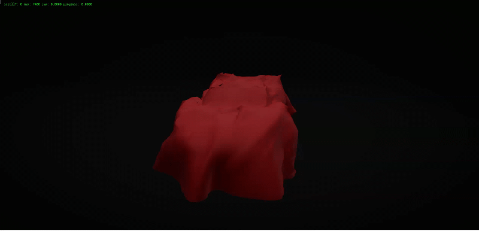
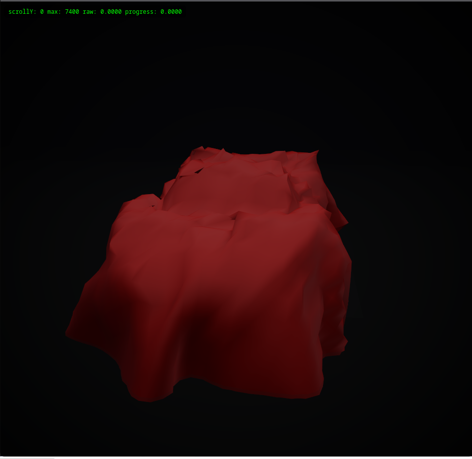
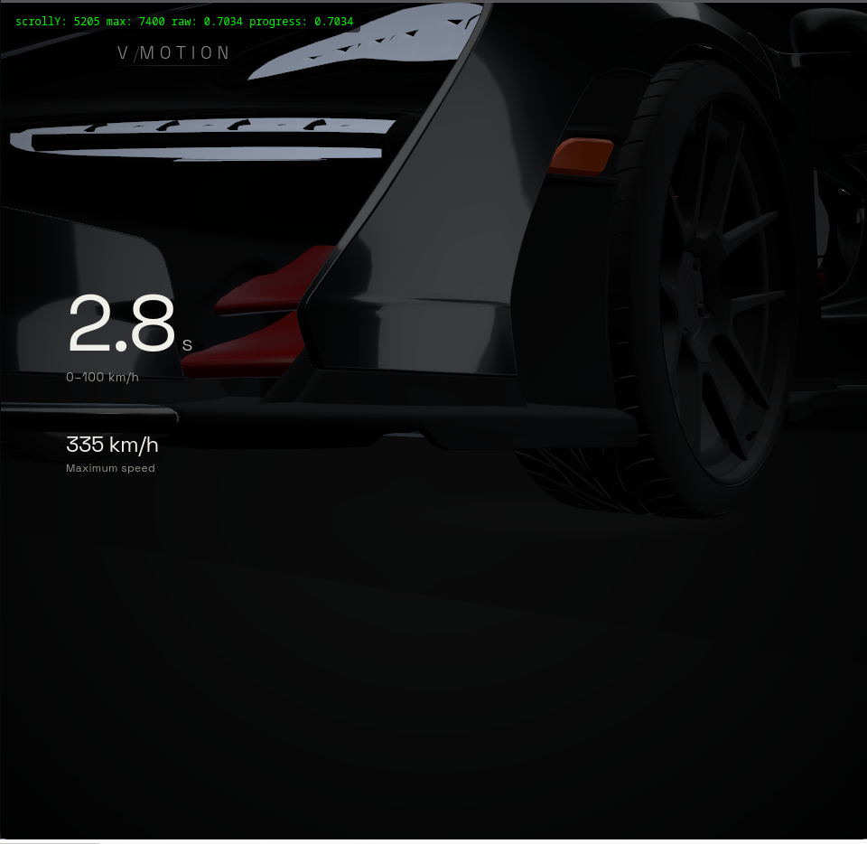
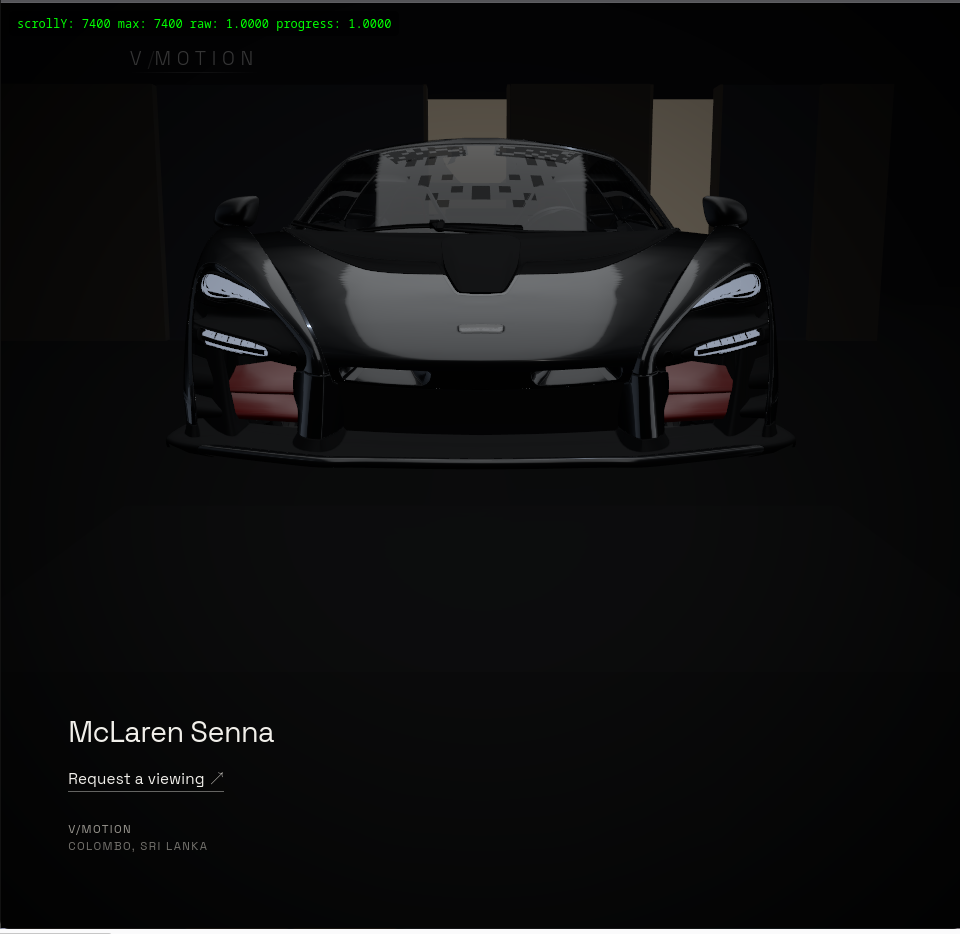

# VINOJAN — Automotive Experience

> A cinematic real-time 3D automotive experience built around darkness, light, motion and interaction.

VINOJAN is a browser-based automotive experience exploring how a performance car can be presented as a cinematic story rather than a conventional 3D configurator.

The project uses the **McLaren Senna** as its visual subject and moves through mystery, reveal, performance and a final interactive gallery experience.

<!-- Replace this with the final hero GIF -->


---

## The Experience

The experience begins with a vehicle hidden beneath a red cover inside a dark studio.

As the viewer scrolls, the lighting gradually disappears and the transition from covered object to McLaren happens inside darkness.

The vehicle is then revealed through controlled reflections before the experience moves into performance-focused cinematography and a restrained architectural gallery.

At the final hero moment, the directed film gives the viewer a small amount of control. Subtle mouse movement changes the viewpoint while the vehicle stays physically planted in the space. When left alone, the studio lighting makes a slow photographic movement across the bodywork.

The intention is simple:

> **Let light reveal the vehicle before the interface explains it.**

---

## Visual Journey

### Mystery

The experience opens with the car concealed beneath fabric in a near-black studio.



### Performance

Camera movement, reflections and typography shift the experience from product reveal into performance storytelling.



### Private Gallery

The final scene introduces subtle architectural depth and restrained viewer interaction while keeping the Senna as the visual focus.



---

## Highlights

- Scroll-directed cinematic camera choreography
- Lights-out vehicle reveal
- Real-time automotive material treatment
- Controlled studio/environment reflections
- Performance-focused editorial typography
- POWER presentation sequence
- Dark architectural gallery environment
- Subtle final mouse-driven camera parallax
- Slow photographic environment-light movement
- Reduced-motion and non-mouse fallbacks
- Responsive real-time WebGL experience

---

## Creative Direction

The project deliberately avoids turning the final result into a typical automotive configurator.

The car does not freely spin.

The camera does not become OrbitControls.

The environment does not rely on neon, particles, holograms or excessive effects.

Instead, the experience uses restraint:

**darkness → form → reflection → performance → presence**

One of the biggest creative decisions was the reveal itself.

A realistic animated cloth removal would have required substantially more model and simulation work. Instead, the transition was reframed as a lighting problem: the studio falls into darkness, the covered model is exchanged for the vehicle, and the Senna emerges as reflections return.

The result uses perception and cinematic timing instead of unnecessary physical complexity.

---

## Living Gallery

The final section changes the relationship between the viewer and the experience.

Until that point, the experience is directed.

The camera, lighting and storytelling determine exactly what the viewer sees.

At the final gallery, that control loosens slightly.

Horizontal mouse movement produces a restrained change in viewpoint rather than rotating the vehicle itself. The Senna remains planted while the viewer appears to take a small step around it.

When interaction stops, the studio environment makes one slow photographic movement across the bodywork before returning to rest.

The intention is not to create another visible effect.

It is to make the vehicle feel physically present.

---

## Technology

The experience is built with:

- **React**
- **Three.js**
- **React Three Fiber**
- **Drei**
- **GSAP**
- **Postprocessing**
- **Space Grotesk**
- **Vite**

---

## Development Approach

VINOJAN was developed as a rapid creative experiment with a design-first, AI-assisted workflow.

My role was closer to an **editor-in-chief and experience director** than a traditional line-by-line programming workflow.

I focused on:

- identifying visual problems
- defining the intended experience
- directing cinematic timing
- evaluating generated implementations
- catching visual and technical regressions
- deciding what should remain restrained
- integrating the strongest solutions into one coherent experience

AI tools were used as technical collaborators for ideation, implementation, investigation and critical review.

The important decisions remained visual and editorial.

A typical iteration followed this pattern:

**Observe → Direct → Prototype → Critique → Verify → Refine**

Instead of asking one AI system to generate the entire project, different models were used for different strengths: creative exploration, critical review and repository-level implementation.

---

## Design Philosophy

### Restraint over effects

The project intentionally avoids adding an effect simply because WebGL makes it possible.

### Perception over unnecessary complexity

When a difficult physical solution can be replaced by a convincing cinematic solution, the experience chooses the simpler system.

### The vehicle remains the hero

Architecture, lighting, motion and typography exist to support the Senna rather than compete with it.

### Directed first, interactive second

The main experience behaves like a short automotive film.

Only after the directed story is complete does the viewer receive subtle control.

---

## Run Locally

Clone the repository and install the dependencies:

```bash
git clone https://github.com/vinojanlk/signature-scroll-experiment.git
cd signature-scroll-experiment
npm install
```

Start the development server:

```bash
npm run dev
```

Create a production build:

```bash
npm run build
```

Preview the production build locally:

```bash
npm run preview
```

---

## Project Structure

```text
src/
├── canvas/       # Three.js / React Three Fiber scene systems
├── core/         # Shared experience logic
├── overlay/      # Editorial UI and storytelling
├── App.jsx
├── index.css
└── main.jsx

public/
└── models/       # 3D assets
```

---

## Author

**VINOJAN**

Colombo, Sri Lanka

Independent automotive experience study.

---

## Note

This is an independent creative study and is not an official McLaren website or commercial product.

McLaren and McLaren Senna are referenced as the automotive subject of the experience. All respective trademarks belong to their owners.
